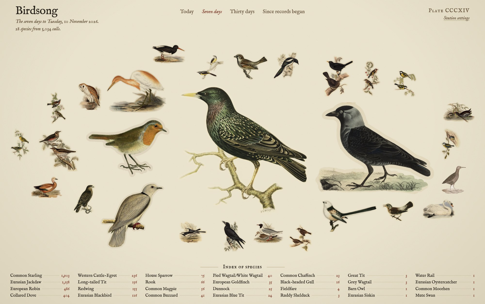
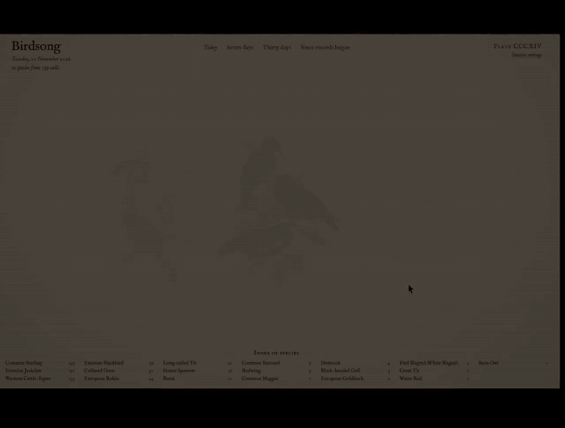

# Birdsong

Birdsong draws the birds your [BirdNET-Go](https://github.com/tphakala/birdnet-go)
station has heard as a single plate of hand-cut 1800s illustrations, each
bird sized by how often it called. It is one small Docker container with
one setting.

Created by [Ed Stone](https://ed-stone.co.uk). Current version: 0.42
([changelog](CHANGELOG.md)); images are also tagged by version, e.g. `:0.42`.

## See it in action

Shown at double speed; [the full recording](docs/birdsong-v0.42.mp4?raw=true) has sound,
including a little owl heard in the small hours.

## What it shows

- **The plate:** every species heard in the chosen period, sized by its
  number of calls, with an index of species and counts beneath.
- **Periods:** today, seven days (the default), thirty days, or since
  records began. The plate refreshes every minute.
- **A card for each bird**, opened by selecting it:
  - the illustration, with the artist credited
  - a sentence or two about the bird, from Wikipedia
  - calls heard, first and last heard, surest identification, how long
    the species has been known at the station, family, order and how
    common it is locally at this season
  - a note when the bird is new to the station, the year or the season
  - calls by hour of the day, and calls each day for the last thirty days
  - the latest recordings, with the weather at the time, playback and a
    spectrogram
  - other illustrations of the species to choose from
- **One-screen mode** (on by default): the plate shrinks so the index
  fits beneath it without scrolling. Switch it off under Station settings.

## Run it

    docker run -d --name birdsong --restart unless-stopped \
      -p 8095:80 \
      -e BIRDNET_URL=http://192.168.1.50:8080 \
      ghcr.io/dopeytree/birdsong:latest

Then open `http://<your-server>:8095`. `BIRDNET_URL` is the address of
your BirdNET-Go as the container can reach it: use the server's IP, not
`localhost`. That is the only setting.

- **Unraid:** install the template from the terminal, then Docker tab,
  Add Container, and choose `birdsong` under Template:

      wget -O /boot/config/plugins/dockerMan/templates-user/my-birdsong.xml \
        https://raw.githubusercontent.com/dopeytree/birdsong/main/unraid/birdsong.xml

- **Compose:** see `docker-compose.yml`.
- **Preview without a station:** open `/?demo` for a sample plate.

If BirdNET-Go has a password or private mode switched on, allow this
container's address in BirdNET-Go's security settings. Recordings and
spectrograms appear only if BirdNET-Go keeps audio clips, and weather
only if it has a weather provider switched on.

## Home Assistant

To put Birdsong on a Home Assistant dashboard, add a new view and give it
the **Grid** layout, then add a single **Webpage** (iframe) card with your
Birdsong address, for example `http://192.168.1.50:8095`. One-screen mode
(on by default) suits the card well.

If you open Home Assistant over HTTPS, the browser will refuse to embed a
plain-HTTP page inside it: serve Birdsong through your reverse proxy with
HTTPS and use that address in the card instead.

## What is inside the image

- The page (`html/index.html`, plain HTML with no build step) and nginx,
  which also forwards `/api` to BirdNET-Go so the page and the data share
  one address.
- About 1,400 bird cut-outs covering some 800 species, from the
  [Fugleramme](https://github.com/arnegiacomo/fugleramme) project,
  fetched when the image is built.
- The IM Fell English typeface.

The image is rebuilt every Monday, which is how new Fugleramme artwork
arrives: update the container as you would any other.

## What still comes from the internet

- A bird with no Fugleramme cut-out falls back to an old plate from
  Wikimedia Commons, cut off its page in the browser. Failing that it
  uses BirdNET-Go's own photo, or just the bird's name.
- The description on each card comes from Wikipedia.

Both are skipped quietly when offline. Everything else is local.

## Settings

"Station settings" on the page holds one-screen mode, an optional
BirdNET-Go address override, and the credits. These settings, the last
period chosen, and any illustration you pick for a bird are remembered
per browser, not shared between devices.

## Build it yourself

    docker build -t birdsong .
    docker build --build-arg FUGLERAMME_REF=v0.21.3 -t birdsong .   # pin the artwork

To pin a species to an illustration of your choice for everyone, add it
to `CURATED_RAW` near the top of the script in `html/index.html`.

## Credits and licences

- Code in this repository: MIT, see `LICENSE`.
- Bird cut-outs: the *classic* style of Fugleramme by Arne Giacomo,
  after Gould, the von Wright brothers, Audubon and others,
  **CC BY-SA 4.0**. The image carries its `ATTRIBUTION.md` and manifest
  at `/art/`. Keep the credit shown on the page if you change it.
- Icon (`unraid/icon.png`): the robin cut-out from Fugleramme, after
  H. E. Dresser, CC BY-SA 4.0.
- Descriptions: Wikipedia, CC BY-SA.
- Fallback plates: public-domain works on Wikimedia Commons, chiefly
  *Nederlandsche Vogelen* (Nozeman & Sepp, 1770-1829), Koninklijke Bibliotheek.
- Typeface: IM Fell English by Igino Marini, SIL Open Font Licence
  (`html/fonts/OFL.txt`).
- BirdNET-Go is a separate project (CC BY-NC-SA 4.0, non-commercial) and
  is not included.
